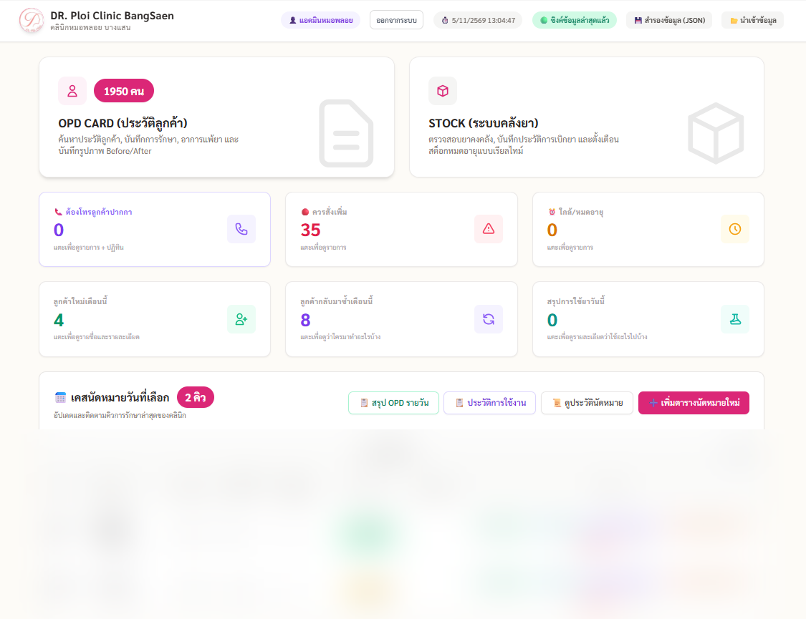
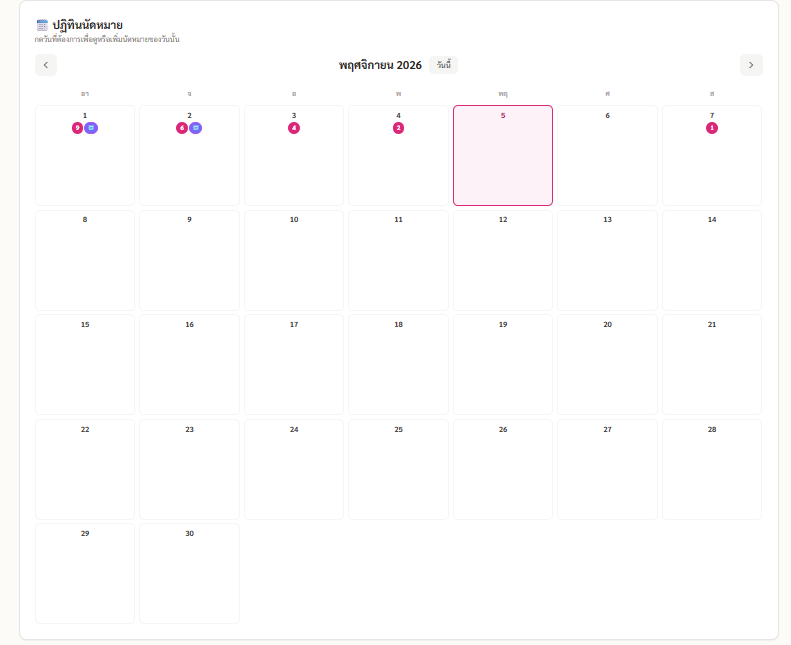
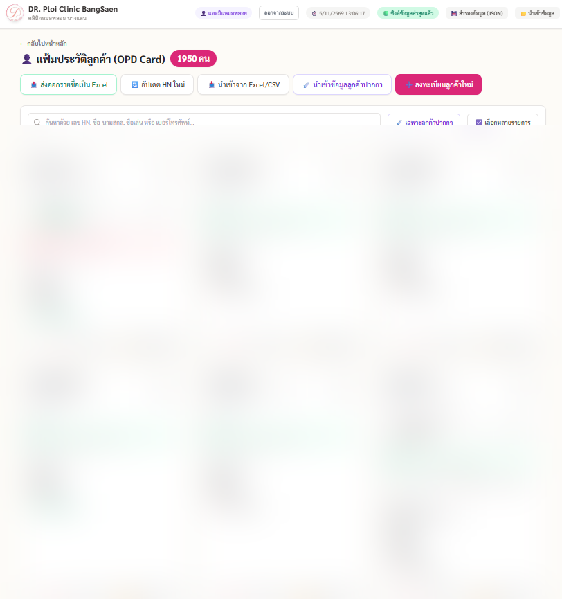
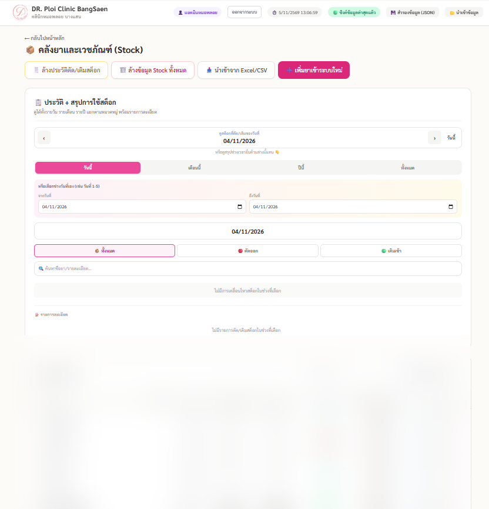
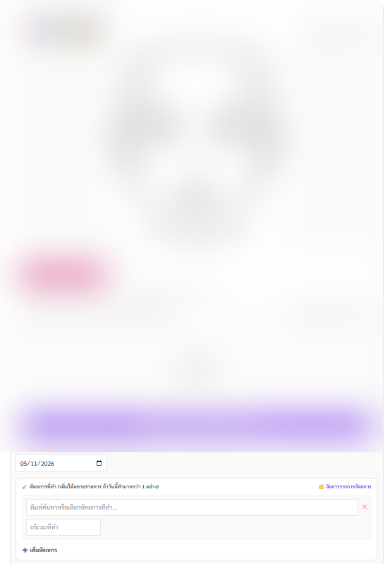
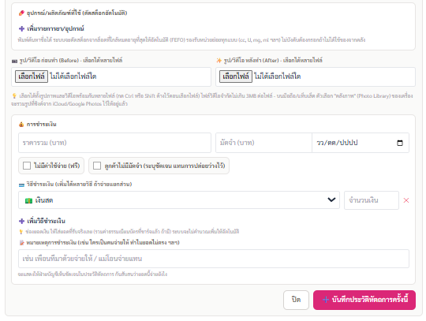
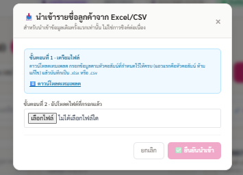
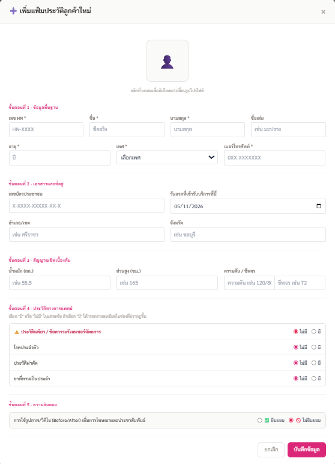

# PUNYAPHA LEESENG
### Junior Full-Stack Web Developer | IT & Digital Technology

Information Studies graduate from Burapha University with hands-on experience in developing web applications, database integration, and digital solutions for real-world business operations.

Passionate about technology, problem-solving, system development, and transforming business workflows into practical digital solutions.

---

## ABOUT ME

- **Name:** Punyapha Leeseng
- **Education:** Bachelor's Degree in Information Studies
- **University:** Burapha University
- **Graduation Year:** 2026
- **Career Interests:** Web Development, Full-Stack Development, IT Systems, Database Management

## TECHNICAL SKILLS

| Category | Technologies & Tools |
|---|---|
| Frontend | HTML, CSS, JavaScript |
| Backend | Node.js, Express.js |
| Database | PostgreSQL, SQL |
| Development | GitHub, Google Apps Script |
| UI/UX & Design | Figma, Draw.io |
| Data Visualization | Power BI |
| AI-assisted Tools | Claude AI, ChatGPT |
| Creative Tools | Canva, CapCut |

---

# FEATURED PROJECT

## Dr.Ploi Clinic Management System

**Project Type:** Clinic Management Web Application  
**Role:** Web Application Developer  
**Project Period:** June 2026 – November 2026

### Project Overview

A web-based clinic management application developed to support daily clinic operations, centralize information management, and improve administrative workflows.

I independently handled most of the development process, covering frontend development, backend functionality, database integration, system testing, and continuous improvements.

### KEY FEATURES

**1. Dashboard & Overview**
- Clinic operational dashboard
- Patient and appointment summaries
- Stock and operational status indicators

**2. Patient Management (OPD)**
- Patient profile management
- Patient information search
- Medical and treatment history
- Before & After photo documentation

**3. Appointment Management**
- Appointment scheduling
- Calendar-based appointment management
- Appointment status tracking

**4. Inventory Management**
- Medicine and medical supply management
- Stock quantity monitoring
- Expiration date tracking
- Stock transaction records

**5. Clinical Documentation**
- Face Chart documentation
- Treatment and procedure records
- Before & After documentation

**6. Data Import & Registration**
- Excel/CSV data import interface
- New patient registration
- New stock item registration

**7. Activity Log**
- User activity history
- Record of system operations
- Activity tracking

---

# PROJECT SCREENSHOTS

### 01. Dashboard & Overview

Main dashboard displaying clinic information, patient summaries, stock status, and appointment overview.

---

### 02. Appointment Calendar

Calendar interface for viewing and managing clinic appointments by date.

---

### 03. Patient Management (OPD)

Patient management interface featuring patient records, search functionality, and patient information.

---

### 04. Inventory Management

Medicine and medical supply inventory interface for monitoring stock quantities, expiration dates, and inventory records.

---

### 05. Clinical Documentation

Clinical documentation interface featuring Face Chart, treatment notes, procedure details, and Before & After documentation.

---

### 06. Excel/CSV Data Import

Data import interface designed to support importing clinic information from Excel and CSV files.

 

---

### 07. New Patient Registration

Patient registration form for entering patient information and relevant medical history.

---

### 08. New Stock Registration

Inventory registration form for adding medicine and medical supply information, quantities, and expiration dates.

---

# TECHNOLOGIES USED

### Frontend
- HTML
- CSS
- JavaScript

### Backend
- Node.js
- Express.js

### Database
- PostgreSQL
- SQL

### Development Tools
- GitHub
- Google Apps Script
- AI-assisted development tools

---

# MY ROLE & RESPONSIBILITIES

As the primary developer responsible for most of the project, my responsibilities included:

- Planning and developing application features.
- Designing user interfaces and system workflows.
- Implementing frontend functionality.
- Developing backend services and application APIs.
- Integrating application data with PostgreSQL.
- Implementing data management and synchronization functionality.
- Testing, debugging, and troubleshooting application issues.
- Improving system usability and functionality.
- Using AI-assisted development tools to support coding and problem-solving while reviewing and validating implementations.

---

# ADDITIONAL SKILLS & INTERESTS

- Graphic Design
- Digital Content Creation
- Data Visualization
- Business Process Improvement
- Workflow Automation
- Information Management

---

# CONTACT

**Punyapha Leeseng**

- **Email:** punyapha.leeseng@gmail.com
- **GitHub:** [github.com/punyapha-leeseng](https://github.com/punyapha-leeseng)

---

*Thank you for visiting my portfolio!*
